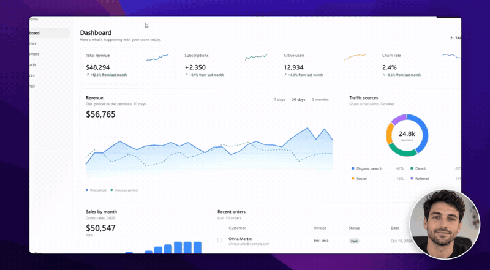
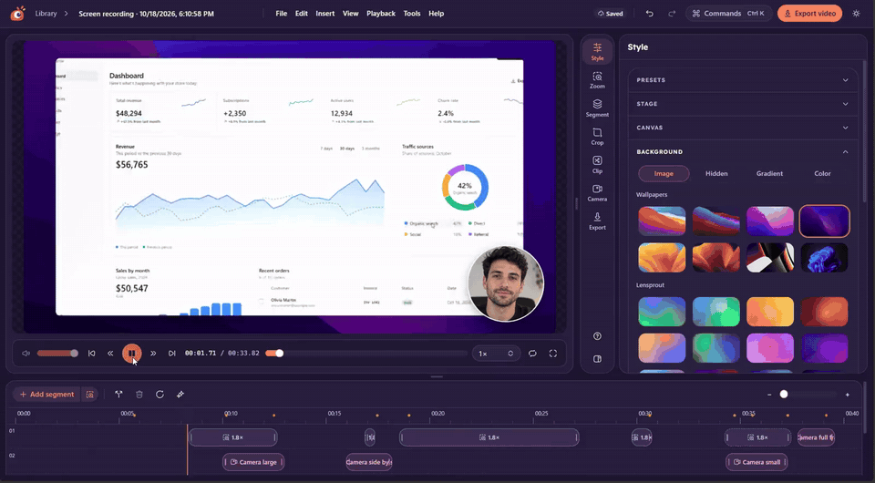
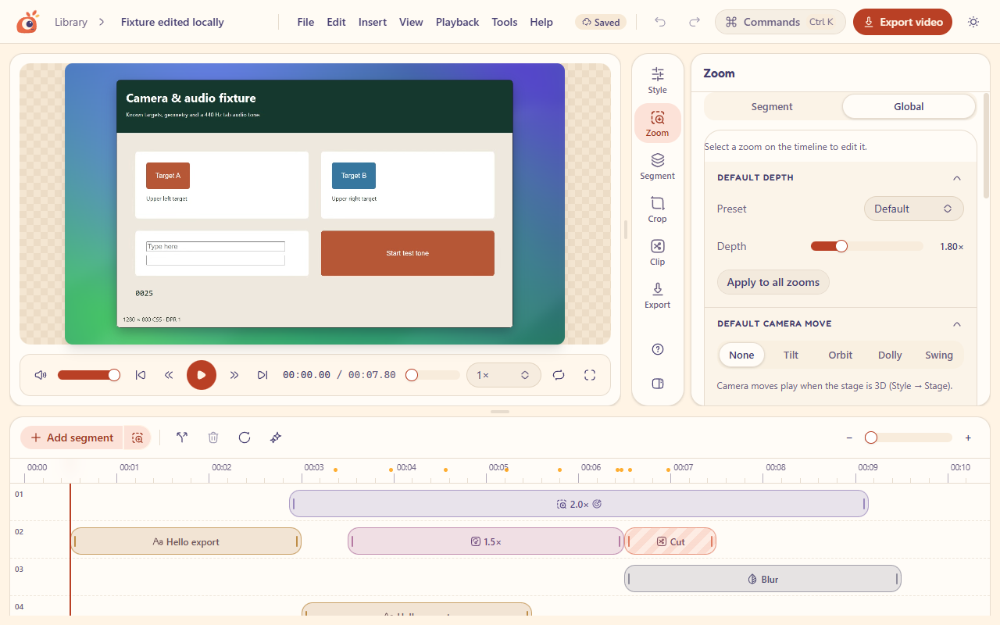
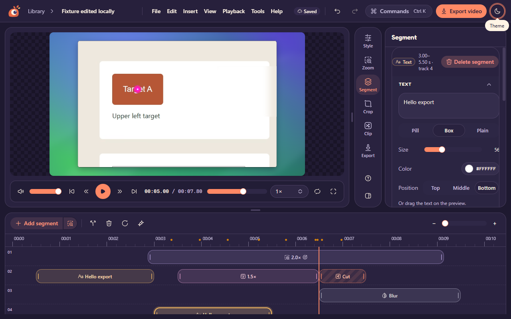
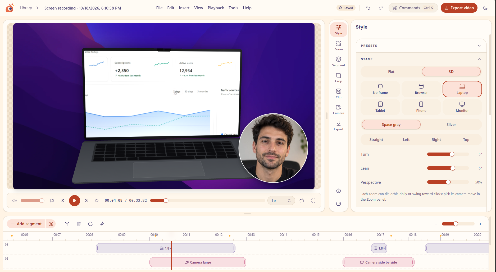
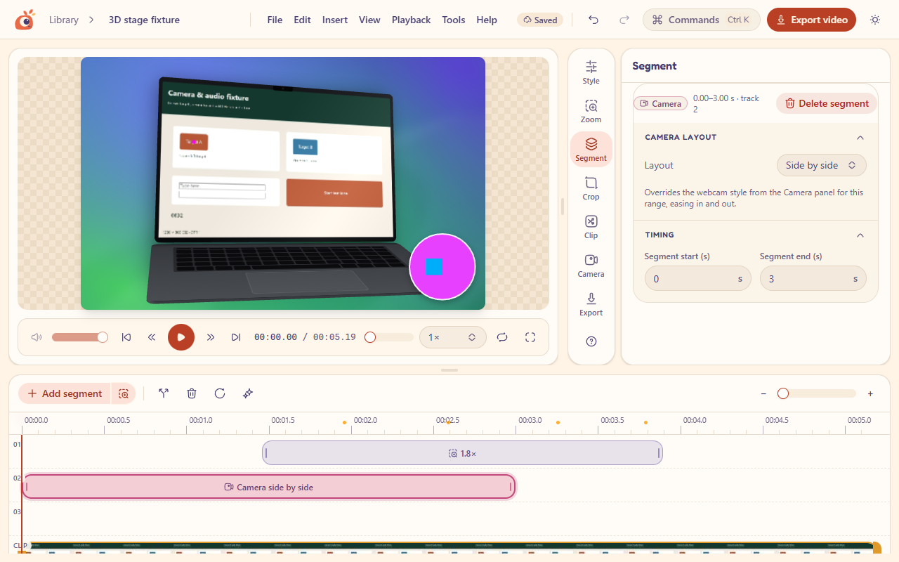
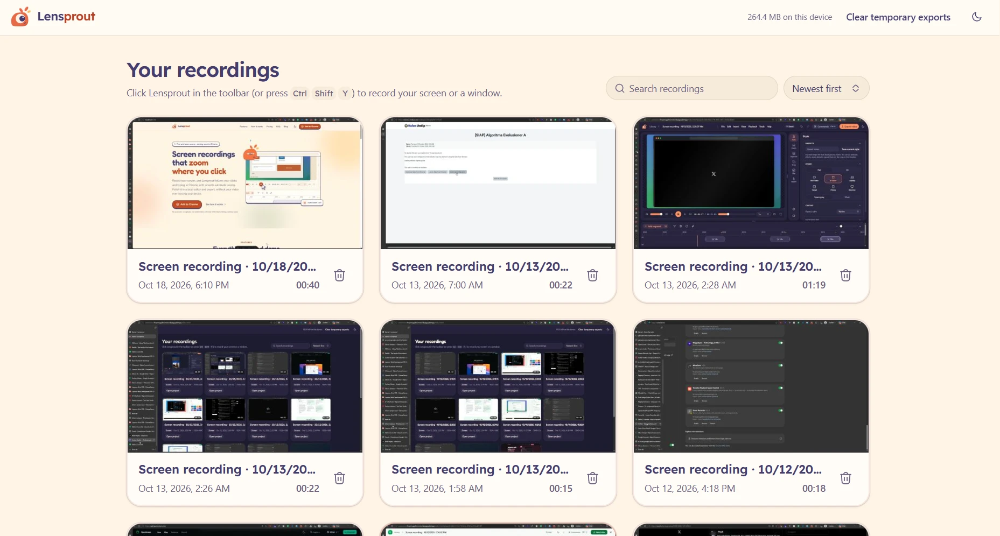
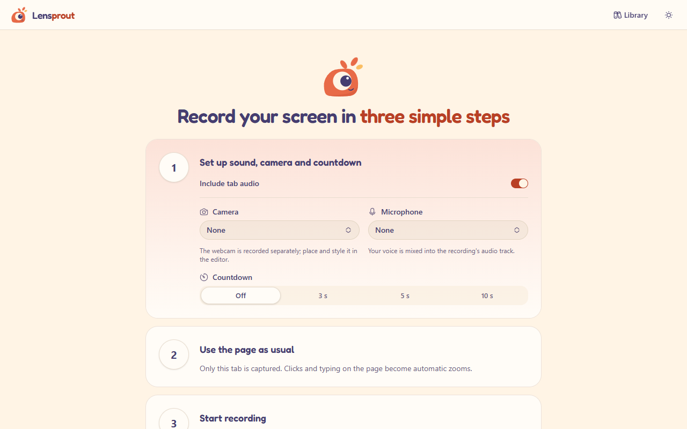

<div align="center">


# Lensprout

**Screen recordings that zoom themselves.**
Record your screen in Chrome, get smooth automatic zooms on every click and keystroke, polish it in a local editor, and export MP4 or GIF. Nothing leaves your device.


[](https://chromewebstore.google.com/detail/lensprout/eoikohnhcikanpomopphklcicidmlkaj)

<a href="landing/public/media/auto-zoom-demo.mp4"></a>

<sub>Exported straight from Lensprout: automatic zoom, webcam layouts and 3D tilt. <a href="landing/public/media/auto-zoom-demo.mp4">Full video (34 s)</a></sub>

</div>

## Why Lensprout

Plain screen recordings are hard to watch: the action is tiny and the viewer has to hunt for the cursor. Lensprout records which clicks and typing happen where, turns them into camera moves, and gives you an editor to fine-tune the result.

- **Zero setup:** a Chrome extension with no account, no upload and no watermark.
- **Edit anything later:** every automatic zoom is a normal segment you can move, resize or delete.
- **Private by design:** recordings, projects and exports live in the extension's own browser storage.

<div align="center">
<a href="landing/public/media/editor-demo.mp4"></a>

<sub>The editor: timeline segments, live preview and the Style panel. <a href="landing/public/media/editor-demo.mp4">Full video (34 s)</a></sub>
</div>

## Core features

### 🎥 Recording
- Record a **screen or a window** through Chrome's picker, up to 4K at 60 fps.
- **System audio** plus a **microphone** mixed in, with a level meter, volume and noise suppression.
- **Webcam**, recorded as its own file so its layout can change later.
- **Countdown** (off, 3, 5 or 10 s) shown on your page, never in the video; Esc cancels.
- **Pause and resume**; start or stop from the toolbar or with **Ctrl+Shift+Y**.

### 🔍 Automatic zoom
- Zooms are generated from **click clusters, long presses and typing**. Password and card fields are ignored.
- A **spring camera** with a dead zone and look-ahead, so moves feel smooth, never jittery.
- **Follow the cursor** with an adjustable **off-center offset**, or pin a **fixed focus** on a minimap.
- **Depth presets**, a default depth, and **regenerate** without losing manual edits.

### ✂️ Editor
- A **multi-track timeline** with zoom, trim, speed, audio volume, text, blur and camera segments.
- **Split, duplicate, multi-select and drag** between tracks, with **undo/redo** and Ctrl + wheel timeline zoom.
- **Smart trim** finds still or idle stretches, typing and silences, and suggests speed-ups and cuts.
- **Crop**, including one-click removal of browser bars from screen captures.
- A desktop-style **menubar**, a **Ctrl+K command palette**, right-click menus, and **light and dark** themes.

### 🎨 Style
- **Backgrounds:** procedural wallpapers, gradients, solid color or your own image, with blur.
- **Frame:** padding, rounded corners and shadow, plus aspect presets (16:9, 9:16, 1:1, 4:3).
- **Vertical fill:** a 9:16 output pans to follow the cursor, which suits shorts and reels.
- **Cursor:** an overlay cursor in five packs, a ring, halo or spotlight highlight, and click animations.
- **Effects:** synthesized **click and keyboard sounds**, motion blur, a shortcut overlay, and **style presets** you can save and set as the default.

### 🧊 3D stage and webcam
- A **WebGL2 3D stage** with tilt, orbit, dolly and swing camera moves, plus 3D motion blur.
- **Device frames** (browser, laptop, tablet, phone and monitor) and **animated backgrounds** (drift, aurora, waves).
- **Webcam layouts:** picture in picture, side by side, stacked or full, switchable per segment with eased transitions.

### 📦 Export
- **MP4** at 720p to 4K, 30 or 60 fps, with audio, encoded locally with WebCodecs.
- **GIF** at 480, 720 or 960 px, 10 to 20 fps, with optional looping.
- Preview and export use the **same renderer**, so what you see is what you get.

## Screenshots

| Editor (light) | Editor (dark) |
| --- | --- |
|  |  |
| **3D stage with webcam** | **3D laptop frame** |
|  |  |
| **Library** | **Recorder** |
|  |  |

## Install

**Chrome Web Store:** [add Lensprout to Chrome](https://chromewebstore.google.com/detail/lensprout/eoikohnhcikanpomopphklcicidmlkaj).

**From source:**

```bash
cd extension
npm ci
npm run build
```

Open `chrome://extensions`, turn on **Developer mode**, click **Load unpacked** and pick `extension/.output/chrome-mv3`. Pin Lensprout to the toolbar.

## Use it

1. Click the Lensprout button or press **Ctrl+Shift+Y**. Choose audio, camera, microphone and countdown.
2. Click **Start recording**, pick a screen or window, and work as usual.
3. Stop from the recorder tab or the toolbar. The editor opens with zooms already placed.
4. Adjust the zooms, add segments and style it, then **Export** as MP4 or GIF.

| Shortcut | Action |
| --- | --- |
| Ctrl+Shift+Y | Start, stop or resume recording |
| Ctrl+K | Command palette |
| Space | Play / pause |
| ← / → (Shift: 1 s) | Previous / next frame |
| A / S / Delete | Add zoom / split / delete segment |
| Ctrl+Z / Ctrl+Shift+Z | Undo / redo |
| Ctrl + / − / 0 | Zoom the timeline in / out / fit |

## Development

| | Extension (`extension/`) | Landing site (`landing/`) |
| --- | --- | --- |
| Install | `npm ci` | `npm ci` |
| Develop | `npm run dev` | `npm run dev` |
| Build | `npm run build` | `npm run build` |
| Check | `npm run typecheck`, `npm test`, `npm run test:browser`, `npm run format:check` | `npm run check` (after a build) |
| Release | `npm run zip` → `.output/lensprout-<version>-chrome.zip` | static `dist/` |

- **Tests:** unit tests run with Vitest. Browser tests drive the built extension in Chromium with Playwright, checking capture, editing, export parity and axe accessibility scans.
- **Store zip:** the release zip has no manifest `key`, so the store assigns the ID.
- **Local wallpapers:** `python extension/scripts/build-wallpapers.py <folder>` turns your own images into a wallpaper pack for local builds. It is never part of a release zip. Only ship images you are allowed to redistribute.

```text
extension/
  entrypoints/      background worker, content script, recorder and editor pages
  src/domain/       project model, migrations, time and edit maps, segments
  src/capture/      recording session, clock, pointer mapping
  src/engine/       zoom planner, camera, renderer, 3D stage, cursor, sounds
  src/export/       MP4 and GIF export worker
  src/storage/      IndexedDB and OPFS store
  src/ui/           editor, timeline, panels, library
landing/            Astro marketing site and blog
docs/               product spec, architecture, decisions, media
```

**Stack:** WXT, React 19, TypeScript, Tailwind CSS v4, shadcn/ui on Base UI, Hugeicons, Mediabunny (WebCodecs), gifenc, WebGL2, IndexedDB and OPFS.

## Docs

- [Product spec](docs/PRODUCT_SPEC.md): scope and acceptance criteria.
- [Architecture](docs/ARCHITECTURE.md): modules, time and coordinate contracts, rendering and export.
- [Decisions](docs/DECISIONS.md): what was chosen and why.
- [Changelog](CHANGELOG.md): changes per version.
- [AGENTS.md](AGENTS.md): conventions for contributors and coding agents.

## License and credits

[MIT](extension/LICENSE).

Built with [shadcn/ui](https://ui.shadcn.com), [Magic UI](https://magicui.design), [Base UI](https://base-ui.com), [Hugeicons](https://hugeicons.com), [Mediabunny](https://mediabunny.dev) and [gifenc](https://github.com/mattdesl/gifenc). Fonts are Fredoka and Nunito (OFL). Full third-party notices are generated into `extension/public/THIRD_PARTY_NOTICES.txt`.
