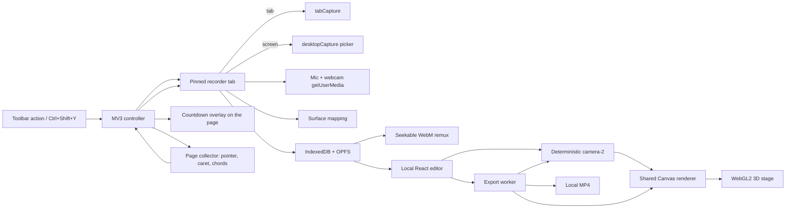

# Architecture · v0.7.x

Authoritative contracts: [model.ts](../extension/src/domain/model.ts) (schema 6), [migrate.ts](../extension/src/domain/migrate.ts), [segments.ts](../extension/src/domain/segments.ts), [edit-map.ts](../extension/src/domain/edit-map.ts) and [crop.ts](../extension/src/domain/crop.ts). New source lives in `extension/`.

## Source map

Paths are relative to `extension/`.

| Module | Source | Owns |
| --- | --- | --- |
| Manifest/build | `wxt.config.ts` | WXT + React, MV3 permissions (tabCapture, desktopCapture, system.display, scripting, …), stable public key, action shortcut |
| Controller | `entrypoints/background.ts` | Session lifecycle, serialized session mutations, action toggle (stop/resume), stream IDs, collector injection per mode, input routing, navigation/tab events |
| Collector | `entrypoints/events.content.ts` | Pointer (client + screen DIP + window metrics, CSS cursor, leave), caret measurement, modifier chords, sensitive-field exclusion |
| Recorder | `entrypoints/recorder/main.tsx`, `devices.tsx`, `src/capture/record.ts`, `clock.ts`, `mapping.ts` | Mode and device choice, stream acquisition, mic mix, main and webcam MediaRecorders, countdown request, pause, surface detection, coordinate mapping, remux, initial project |
| Domain | `src/domain/` | Schema 4 types/validation, migrations 1→4, raw/logical time map, segments/edit map/crop, edit commands |
| Engine | `src/engine/` | Planner, camera-2 (offset, 3D poses), renderer (`render.ts`: `renderScreen` + flat or staged composite), backgrounds, overlays (`effects.ts`), cursor and packs (`cursor.ts`), composition layout (`webcam.ts`), 3D stage (`stage.ts` geometry, `stage-gl.ts` WebGL2, `stage-render.ts`, `devices.ts` textures) |
| Store | `src/storage/store.ts` | IndexedDB v4 (migration in upgrade), OPFS media/webcam/backgrounds/exports, revisions, cleanup |
| Editor | `src/ui/` | Editor state/preview, Timeline, panels (Style/Zoom/Clip/Help), ExportDialog, Library, thumbnails, icons, light theme CSS |
| Export | `src/export/` | Module worker; Mediabunny/WebCodecs conversion with shared rendering |

Recorder and editor are normal extension pages. There is no Chrome offscreen document, website, backend or native bridge.

## Capture and lifecycle

The action opens a pinned `recorder.html?session=<UUID>` at index 0 in the current window. It stores `sourceTabId` (only for HTTP/HTTPS tabs), `sourceWindowId` and `returnTabId` in `chrome.storage.session`.

While a session exists, a second action click is a toggle:

- recording → `control: stop`;
- paused → `control: resume`;
- ready → focus the recorder.

The background caches the session and serializes mutations through a promise queue.

**Tab mode.** The controller calls `tabCapture.getMediaStreamId` with explicit target and consumer IDs. The recorder consumes it with `chromeMediaSource: 'tab'`, and an AudioContext plays the tab's audio back.

**Screen mode.** The recorder calls `chrome.desktopCapture.chooseDesktopMedia(['screen','window','audio'])` *before* telling the controller, so a cancelled picker leaves the session reusable. It then consumes the stream with `chromeMediaSource: 'desktop'`. System audio is only requested when Chrome offers it.

Both modes use mandatory limits `minWidth/minHeight 16`, `maxWidth 3840`, `maxHeight 2160`, `maxFrameRate 60`. Tab mode lowers the maximum to the page's viewport × DPR, measured by the controller at capture time (D42), so Chrome does not upscale. Recording dimensions come from the decoded file. A max-only set made Chrome letterbox to the max aspect ratio (D24). MediaRecorder picks VP9/Opus, VP8/Opus or WebM. The bitrate is `w·h·fps·0.1`, clamped to 6–30 Mbps, with chunks about every second.

The epoch is set immediately before `MediaRecorder.start()` (D19). Pauses disable tracks, and encoding stays continuous. Stopping:

1. finalizes writes and computes the raw duration;
2. remuxes the WebM (packets copied, cues and duration written, trim start 0, duration checked);
3. plans zooms and atomically saves the recording and project;
4. deletes the un-remuxed file.

A 30-minute wall-clock guard stops the recording.

## Lensprout UI and quick wins (v0.7.0)

**UI stack:**

- shadcn/ui Base UI components in the **base-maia** style live in `src/components/ui/`. They are fetched by `scripts/shadcn-add.mjs` (icon placeholders → Hugeicons, imports → `@/src`); local patches are listed in `registry.json`.
- Variants and keyframes come from `src/ui/shadcn-tailwind.css` (vendored).
- App helpers in `src/components/app/app.tsx`:
  - `Choice` (Select), `TileGroup` (ToggleGroup grid), `ColorPicker` (Popover);
  - `RailButton`, `Segmented`, `SwitchRow`, `FieldRow`, `NumberField`.
- Icons come from `src/components/app/icons.tsx`. Brand pieces are in `src/components/brand/`.
- The theme provider also persists the font (`data-font`).

**Editor shell.** The header holds the logo, breadcrumb, project name and `EditorMenubar` (File/Edit/Insert/View/Playback/Tools/Help, the same actions as the palette), then save state, undo/redo, the palette, Export and the theme. A labelled rail sits beside the inspector.

**Export formats.** `ExportRequest.gif` selects `runGif`. Both paths share `forwardReader` (forward-only decoded frames, drawn into a canvas) for the source and the webcam.

**Sounds.**

- `soundCues(project, events, editMap)` gives cues in output time, from pointer-downs and from caret/chord events (merged within 45 ms).
- `mixCues` adds the seeded synthesized samples.
- Export mixes them into each output audio sample. Without source audio, a composable conversion drives video while the worker feeds an `AudioSampleSource` and starts and finalizes the output itself.

**Smart trim.** `analyze.worker.ts` produces measurements → `staticRanges`/`silentRanges` → `toLogical` → `suggest` → `applySuggestions`, which places segments on free tracks and skips exclusive speed overlaps.

**Fill.** `viewExtents(project, w, h)` returns `{fx, fy}`. The camera uses half-extents `fx/(2·zoom)` and `fy/(2·zoom)`, plus dead zone and offset scaled per axis. The renderer's `drawSource`/`toBox`/blur/click mapping use the same extents, and the stage builds the device around the view aspect.

**Presets.** `extractStyle`/`applyStyle` (`src/domain/presets.ts`) are validated by `validateProject`. `record.ts` applies the default preset before planning zooms.

## 3D stage (v0.6.0)

**When.** `needsStage(project)`: `stage.mode === '3d'`, a device other than none, or background motion. Otherwise the flat v0.5 path runs unchanged.

**Pipeline per frame** (`renderStaged`):

1. Geometry: `deviceLayout` sizes the face (bezel + screen) around the cropped-source aspect; `buildDevice` makes meshes in local space (origin = face center, y down, +z toward the viewer).
2. Poses: one per motion sample with a distinct yaw/pitch/roll/push (from `Camera`); flat mode uses zero.
3. Placement: `placeDevice` rotates (roll → yaw → pitch), fits every vertex into the screen container at push 0 (iterative), then moves the eye to `focal × (1 − push)`.
4. Screen texture: `renderScreen` at the projected size (scaled up by 1/(1 − push)), then `drawFace` composes bezel, notch and screen.
5. Static textures (deck, shadow) redraw only when their key changes.
6. `stage-gl` draws the background (with motion), then the shadow quad (no depth), then the meshes with depth.
7. The result is copied into the 2D output, followed by the chord pill, webcam and text.

**Projection.** Pinhole about the container center: `x' = c + (x − c)·focal/(eye − z)`, with `focal = (H/2)/tan(fov/2)` and `fov = 15°–45°` from `perspective`. Depth is hyperbolic NDC from the eye distance. Perspective-correct texturing comes from per-vertex w.

**Meshes.** `slab()` extrudes a rounded outline along −N with a thickness that can vary along v (the laptop base is a wedge). Top faces map textures across the outline bounds. Sides carry smooth outline normals.

- Laptop: lid slab + base slab hinged 20° below horizontal toward the viewer.
- Monitor: lid + neck + foot.
- Phone/tablet/browser/none: one slab.

**Lighting.** Per-vertex Blinn-Phong (`shade`): light from the upper left in front, ambient 0.42, diffuse 0.62, specular exponent 48. The screen is unlit, with a glass glare band whose position follows yaw.

**Motion blur.** With several poses, each pose renders into a 4× multisampled color+depth layer, is resolved into a texture and averaged into an accumulator (weight 1/(i+1)), then composited over the background.

**Background motion** (`stage-gl` BG shader, time = logical seconds × speed):

- Drift: zoom 1.12 ± 0.05 and a slow pan.
- Waves: sine displacement.
- Aurora: noise flow plus three moving light blobs.

**Camera moves** (`camera.ts`, strength s, sign from direction):

- tilt: yaw ±18s, pitch −8s, roll ±2s;
- orbit: yaw ±22s → ∓22s across the zoom, pitch −6s;
- dolly: push 0.25s, pitch −4s;
- swing: yaw −(x − 0.5)·40s and pitch −(y − 0.5)·24s from the lookahead pointer.

Rotation decay is 0.28 s in, 0.35 s out and 0.3 s for swing; resting `stage.tilt` applies outside moves. Limits: yaw ±35°, pitch ±30°.

**Layouts** (`compositionLayout`):

- PiP keeps the whole frame for the screen;
- side by side and stacked split it (camera share `split`; the corner picks the camera side);
- full gives the camera the whole frame;
- hidden removes the webcam.

Segments ease both rects over 300 ms. `frameRect` and the stage fit inside the screen container.

## Recorder extras (v0.5.0)

**Order in `startRecording`:** open mic/webcam (`getUserMedia`, mic constraints from the Noise suppression switch) → acquire the tab/screen stream → surface detection and audio graph → countdown → save the recording row → create the main and webcam recorders → epoch + main `start()` → webcam `start()` → session `recording`.

**Audio graph.** With a mic, one `AudioContext` mixes `captured audio` and `mic → gain (0–3)` into a `MediaStreamAudioDestinationNode`; the main recorder encodes `[video track, mixed track]`. Tab audio is also connected to the speakers; the mic is not. Without a mic the v0.4 path is unchanged. `Recording.hasAudio` is true when the encoded stream has an audio track.

**Webcam.** `webcam-<session>.webm` from a second MediaRecorder (VP9/VP8, 2.5 Mbps, 1280×720 ideal, ≤30 fps). `offsetUs = round((webcamEpoch − mainEpoch) × 1000)`; both epochs are taken just before their `start()`. Pause/resume toggles all tracks, so the webcam shares the main pause map. At stop the webcam is finished before the tracks are released, decoded for size and duration, and remuxed; failure removes it and leaves `Recording.camera` unset. Deleting a recording removes the webcam file.

**Countdown.** `request({type:'countdown'})` runs outside the controller's serialized queue (so the toolbar can cancel it): status `countdown`, overlay in the source tab (tab mode) or the active HTTP tab of the last focused window (screen mode), badge 3-2-1, one tick per second. Esc in the overlay sends `countdown-cancel`; a toolbar click during `countdown` cancels too. The reply is `{cancelled}` after the overlay is removed and two frames have painted in that page. Cancel → recorder stops every track and throws `CancelledError`; the controller drops `mode`, so `capture` can run again.

**Collector additions.** 16 ms pointer-move sampling; `cursor` from `getComputedStyle(target).cursor` (`pointer`, `text`, `grab`, `default`→arrow, others→`other`; `auto` guesses pointer for links/buttons/labels and text for text inputs/contenteditable); `pointerout` with no `relatedTarget` → `pointer-leave` at the exit point.

**Cursor rendering** (`cursor.ts`). The track holds pointer events in crop space with no smoothing (linear only across gaps ≤120 ms), so the overlay covers Chrome's burned-in cursor. Real cursor height = 22 CSS px / viewport CSS height / crop height; output size = that × camera zoom × frame height × overlay size. Highlight radius = 1.25 × real height × size; spotlight darkens the frame outside 1.6 × radius. Drawn inside the frame clip after blur, before clicks.

**Webcam rendering** (`webcam.ts`). Base box from corner, size and margin (fractions of the output's short side; circle is square, other shapes 4:3). Segment layouts: small 0.6×, large 1.6× (capped at 0.6 of the short side), hidden fades out, fullscreen fills the canvas. Transitions ease over 300 ms at both segment edges. Drawn after the chord pill and before text.

**Offset.** In follow mode the camera goal is `lookahead pointer − offset / depth` per axis, then clamped; the dead zone compares against that goal.

**Editor and export sync.** Preview: a hidden webcam `<video>` is driven from `draw()` to `main.currentTime − offsetUs` (exact when paused, corrected beyond 80 ms while playing, rate mirrored). Export: a forward-only `VideoSampleSink.samples(start)` iterator returns the latest webcam frame at or before each output frame's raw time − offsetUs; decode errors drop the webcam for the rest of that export.

## Input collection and coordinates

The collector is injected at runtime:

- **Tab mode:** the source tab's top frame, again on its top-frame navigation.
- **Screen mode:** every window's active HTTP/HTTPS tab with `allFrames`, plus tab activation and frame commits.

It sends:

- primary pointer down/up/move (move at most every 32 ms);
- caret position on `input`, trailing-throttled to 80 ms;
- modifier chords (Ctrl/Alt/Meta + key) as labels such as `Ctrl+K`.

Inputs whose type is not text-like, and fields with password/one-time-code/card autocomplete, are excluded from caret and chord collection. Plain typed text is never sent.

Each measurement carries client px and viewport size/DPR, screen DIP coordinates and window bounds. Screen coordinates use the frame's origin learned from pointer events (`screenX − clientX`); the top frame falls back to an estimate from window metrics.

`mapEvent` in `src/capture/mapping.ts` normalizes a measurement into the captured frame:

| Surface | Rule | Rejects |
| --- | --- | --- |
| tab | `clientX/innerWidth`, `clientY/innerHeight` | subframes |
| monitor | `(screen − display.bounds.origin) / display.bounds.size` (DIPs from `chrome.system.display`) | points outside that display |
| window | relative to the event's own window; visible size `frame/DPR`; horizontal border `(outer − visible)/2`; no top border | windows whose size or aspect does not match the current frame |

The current frame size comes from a detached video element on the stream. The monitor is chosen by aspect-ratio match (2%), then by the display containing the browser window. If nothing matches, `pointerTracked` is false and no automatic zoom is generated. Geometry IDs are `w:h:dpr`, `display:w:h` or `window:w:h`.

## UI layer (v0.4.0; superseded by v0.7.0 above)

- **Stack:** React 19 + Tailwind v4 (`@tailwindcss/vite`), with shadcn-style components from uiable's **free** registry on Base UI, lucide icons, sonner toasts, a cmdk command palette and react-resizable-panels.
- **`components.json`** documents aliases (`@/src/components/ui`, `@/src/lib/utils`) and the `@uiable` registry URL.
- **Adding a component:** `node scripts/uiable-add.mjs <item>`. It resolves registry dependencies, rewrites imports, rejects Pro items and updates `src/components/ui/uiable-registry.json`. Install any npm dependencies it prints with exact versions, then re-apply the ledger's `localChanges` if a patched file was overwritten.
- **Tokens** live in `src/ui/globals.css`:
  - `:root` and `.dark` shadcn names, plus `--seg-*`, `--stage` and `--trim`;
  - `@custom-variant` for `dark`, `data-horizontal` and `data-vertical`;
  - `.segment[data-kind]` coloring for timeline items.
  The rendered video never uses UI tokens; its colors are project data.
- **App components** (`src/components/app/app.tsx`): `AppProviders` (theme, tooltips, toaster), `AppHeader` (brand, breadcrumb, actions, theme toggle, `UpdateNotice`), `IconAction` (icon button + tooltip + shortcut), `Segmented` (ToggleGroup), `SwitchRow`, `FieldRow`, `NumberField`.
- **Theme** (`src/ui/theme.tsx`): light, dark or system, stored in `chrome.storage.local`, which keeps the recorder and editor in sync. The header toggle is the vendored Magic UI `AnimatedThemeToggler` (View Transitions reveal, plain switch under reduced motion; D70).
- **Inspector layout:** each panel's content starts below the header with 16 px padding. `Inspector` is a bordered accordion card; `Section` rows and always-visible `Block` rows share a 16 px inset and dividers. `Segmented` pills shrink and truncate so narrow inspectors never scroll sideways.
- **Editor layout:**
  - a vertical `ResizablePanelGroup` (workspace / timeline);
  - inside the workspace, a horizontal group (preview / collapsible inspector);
  - both layouts persist through `useDefaultLayout` in localStorage;
  - the inspector body is a ScrollArea, and each panel is an `Inspector` (Accordion) whose closed sections persist per panel.
- **Feedback:**
  - transient errors become toasts;
  - save failure is a persistent destructive Alert with Retry;
  - export errors appear inside the export Dialog;
  - destructive library actions use AlertDialog.
- **Timeline interactions:**
  - pointer drag logic is unchanged;
  - one ContextMenu wraps the scroll area, and `onContextMenuCapture` records the target segment or lane time;
  - Add menu = DropdownMenu.

## Segments, tracks, edit time and crop (v0.3.0)

**Items.** A timeline item is either a zoom (`project.zooms`, the only thing that drives the camera) or a segment (`project.segments`): `cut`, `speed` (one of `SPEEDS`), `audio` (volume 0–1), `text` or `blur`.

- Every item has `track` (0–31).
- **Rules** (enforced by `validateProject`, the commands and `moveItems`):
  - items on the same track never overlap;
  - zoom, speed and audio never overlap their own kind on any track.
- `place` puts new items on the lowest free track.
- `moveItems` takes a time delta plus a track delta, clamped by conflicting neighbors. If the target track is occupied at the original time, the item stays on its track.
- `settleTracks` re-homes regenerated zooms that would collide.

**Edit time.** `createEditMap(project)` splits the trim range at every segment boundary, drops cut ranges, and records each kept piece's speed, volume and output start.

| Function | Returns |
| --- | --- |
| `toOutput` | output time for a logical time |
| `toLogical` | logical time for an output time |
| `pieceAt` | the kept piece at a logical time |
| `nextKept` | the next kept logical time |
| `durationUs` | output duration |

Validation requires at least 0.1 s of output. Logical time remains the timeline's axis, and camera, overlays and segments stay in logical time.

**Preview** playback:

- skips cuts (`nextKept`);
- sets `playbackRate = rate × speed` and `volume = volume × pieceVolume`;
- sets `preservesPitch = false`;
- shows output time on the clock.

**Export:**

- For each decoded source frame covering logical `[l0, l1)`, the worker emits every output-grid frame `k/fps` whose time maps into that interval. Each frame is rendered at `toLogical(k/fps)`, so slow motion duplicates frames and fast motion drops them deterministically.
- Audio is split per piece. Pieces at speed 1 and volume 1 are trimmed exactly; other pieces are copied as f32-planar, linearly resampled by speed (pitch follows) and scaled by volume.

**Crop.** `composition.crop` is a normalized source rectangle (≥10%) and defines the **camera space**:

- `createCamera` maps pointer samples with `cropEvents`, and its cache is keyed by the crop.
- `createOverlays` drops clicks outside the crop and maps the rest.
- The renderer draws `sourceRect(crop × camera view)`, and `frameRect` and the native `outputSize` use the cropped size.
- Fixed focus points, minimaps and blur rects are in crop space.
- Text positions are in output space.

For screen/window captures, `viewportRect` records where a page viewport sat in the frame (from the pointer's screen−client offset). `Recording.viewports` keeps the 8 most frequent; “Crop browser bars” applies the top one.

**Overlays in `renderFrame`:**

- blur, inside the frame clip, after the source;
- click effects;
- the chord pill;
- text with an 180 ms fade, wrapped at 80% width.

**Timeline UI:**

- numbered lanes (the highest used track + 1 empty lane) and a clip lane with cut shading;
- the “Add segment” menu;
- Ctrl/⌘+wheel zooms around the pointer;
- Ctrl/⌘ `=` / `−` / `0` zoom in, out or fit; both are prevented from zooming the page.

## Raw versus logical time

Unchanged from v0.1. Raw time is the continuous WebM timeline. Logical time removes the ordered half-open pause intervals and is used by input, trim, zooms, camera and overlays. Every conversion goes through [time-map.ts](../extension/src/domain/time-map.ts). Remuxing preserves raw timestamps.

## Domain and storage

Schema `5`, engine `camera-2`. Schema 5 adds `stage`, `Zoom.move`, `composition.backgroundMotion`, `cursor.overlay.pack`, `webcam.layout/split` and three camera layouts (see "3D stage"). Schema 4 adds `pointer-leave`, `InputEvent.cursor`, `Recording.camera`, follow `focus.offset`, `autoZoom.offset`, `webcam`, `cursor` and the `camera` segment (see “Recorder extras”). Schema 3 added segments, tracks and crop (section below). The fields below were introduced in schema 2.

- `Recording` adds `source` (`tab|monitor|window`) and `pointerTracked`.
- `Project` replaces the fixed output size with:
  - `composition` (aspect, background union, padding fraction, radius at 1080, shadow);
  - `effects` (click style/force/color, motionBlur, keystrokes);
  - `output` (quality = short side 720/1080/1440/2160, fps 30/60);
  - `autoZoom` (depth, typing).
- Events may be `caret` or `chord` (chords carry `keys`).

Validation covers every field, including the background union and safe custom-background names.

IndexedDB `zoom-recorder` version 6 migrates schema-1–5 recordings and projects in the upgrade transaction (5→6: contain fit and sounds off; 4→5: flat stage, no device, still background, classic pack, PiP). Schema 2→3 adds track 0 to zooms, an empty segment list and a full-frame crop; 3→4 adds a zero offset, the default webcam style and a disabled cursor overlay/highlight. Migration keeps the old look: color background, no effects, 30 fps, aspect from the old size. OPFS holds `recording-*.webm`, `background-<uuid>` custom images and temporary `export-*.mp4`. Library cleanup removes temporary exports and unreferenced backgrounds. Deleting a recording deletes its media, project, events and custom background.

The editor has 100-step undo; edits that share a key coalesce within 1.5 s (name typing, sliders). Autosave is debounced 400 ms, serialized and revision-checked, and only saves committed projects, never drag previews.

## Planner (`src/engine/planner.ts`)

Constants are in `PLANNER`:

- 500 ms anticipation;
- 100 ms release;
- 3 s merge gap;
- separate after ≥1 s when the distance exceeds 50% of the surface diagonal (pixel size from geometry);
- presses over 2 s are kept;
- isolated brief actions are dropped;
- no starts in the last second.

Caret events form typing periods (gap ≤3 s, broken by a pointer down; 0.6 s tail). Each period becomes a synthetic press. Generated zooms use `autoZoom.depth`, and regeneration preserves manual zooms. This is independent code, not a port.

## Camera (`src/engine/camera.ts`)

The camera uses fixed 60 Hz integration of exact critically damped springs:

- pan time constant 0.17 s;
- zoom in 0.16 s, zoom out 0.22 s;
- a snap when the residual is under 1e-5.

**Follow mode:**

1. On entering a zoom, aim at the pointer track at `t + 1.5 × 0.17 × √depth`.
2. Afterwards, hold the center until the look-ahead point is more than `0.33/depth` away on an axis.
3. Then retarget.

Pointer samples are linearly interpolated across gaps of 250 ms or less; caret samples are held. Targets are clamped to the visible bounds for the target depth. **Fixed mode** targets the point.

`at(t)` interpolates neighboring states, so motion-blur samples and any output fps are smooth. Seeking returns the same state at the same time. `createCamera(project, events, previous)` keeps cached states before the first changed zoom (the same events array is required).

## Rendering (`src/engine/render.ts`, `backgrounds.ts`, `effects.ts`)

`outputSize` comes from the aspect (native uses the recording size) and the quality (short side), with the long side capped at 3840 and even dimensions.

`frameRect` contains the source inside `padding × min(W, H)`. Radius and shadow scale with `min(W, H)/1080`. A hidden background fills the canvas with no padding or styling.

`renderFrame` draws, in order:

1. the background canvas, painted once per size by `paintBackground` (color, gradient preset, procedural wallpaper with blur, custom image cover with blur, or a local-pack wallpaper (`wallpaper` type, loaded by `loadBackgroundSource` in `src/storage/store.ts` from `wallpapers/<id>.webp`; local builds only, D71));
2. the shadow;
3. the clipped frame, averaged across `motionSamples`: up to 8 cameras over a half-frame shutter, only while the camera moves;
4. clicks (orb/ring for 550 ms, size scaled by force and zoom);
5. the chord pill (1.3 s).

Preview and export call the same function. The preview renders at canvas pixels: the stage size × DPR, capped at the output size.

## Editor preview

The source `<video>` stays rendered: tiny, opacity 0.01, not `display:none`. A requestAnimationFrame loop draws while playing; it skips pause ranges, stops at the trim end or loops. When paused, drawing happens on seek, load, edit and resize. Camera time comes from the playback clock (`currentTime`), not `requestVideoFrameCallback`: VFR tab captures can present frames sparsely, and the camera must keep moving between them.

The timeline renders at px-per-second between fit and 480 px/s, keeping the playhead in place while zooming. It provides:

- ruler ticks (5 minor per major);
- scrub on the ruler and playhead knob;
- drag-move and edge-resize through `moveZooms`/`resizeZoom`, previewed during the drag and committed on release;
- shift-click multi-select, double-click add, split at the playhead;
- trim handles via `setTrim`;
- a Mediabunny CanvasSink filmstrip (≤160 thumbs, debounced, abortable);
- click markers.

## Export

The editor freezes the project and starts the bundled module worker. The worker:

1. preflights H.264 at the output size and fps, and AAC when audio is present;
2. paints the background (loading a custom image from OPFS);
3. builds the camera and overlays;
4. runs Mediabunny Conversion with `frameRate = output.fps`.

Mediabunny pads frame-rate gaps by re-calling `process`, so camera motion stays smooth over static source content. Raw/logical retiming and audio splitting are unchanged from v0.1. Cancel or error removes the partial output.

## Practical boundaries

- Pointer tracking only covers Chrome web pages, in their top frame for tab mode and in all frames for screen mode.
- Other apps and browser UI are not tracked.
- The cursor is drawn by Chrome/OS into the captured frames. It can be covered (overlay) and highlighted, but not removed, smoothed or swayed; fast moves between 16 ms samples can briefly reveal it.
- Webcam/screen sync relies on the start-epoch estimate (D47); lip-sync is not measured.
- The countdown cannot appear on pages Chrome forbids extensions to script (badge only).
- The recorder offers screen/window capture only; tab capture is internal test plumbing (D57).
- 3D needs WebGL2 in both the page and the export worker; headless tests use SwiftShader, so real-GPU appearance and speed are unverified.
- The 30-minute guard is not a measured performance limit.
- Browser zoom, mixed DPI, identical monitors and non-Windows window borders are unverified.

Primary API references: [tabCapture](https://developer.chrome.com/docs/extensions/reference/api/tabCapture), [desktopCapture](https://developer.chrome.com/docs/extensions/reference/api/desktopCapture), [system.display](https://developer.chrome.com/docs/extensions/reference/api/system/display), [WXT](https://wxt.dev/guide/essentials/entrypoints), [Mediabunny](https://mediabunny.dev/guide/converting-media-files).
